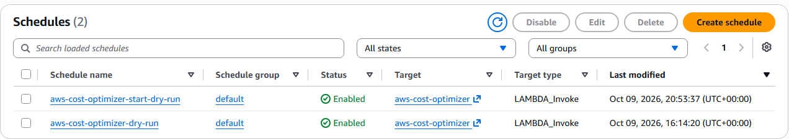

# Automated AWS Cost Optimizer

## Project Overview

This project uses AWS Lambda and Amazon EventBridge Scheduler to identify eligible development EC2 instances and simulate scheduled start and stop actions to help optimize AWS costs.

## AWS Services Used

* **AWS Lambda** — Runs the Python automation code.
* **Amazon EC2** — Provides the instances targeted by the optimizer.
* **AWS IAM** — Controls permissions for the Lambda function.
* **Amazon EventBridge Scheduler** — Triggers the Lambda function on a schedule.
* **Amazon CloudWatch** — Stores Lambda execution logs.

## How It Works

1. EventBridge Scheduler invokes the Lambda function.
2. Lambda checks EC2 instances using their tags and current state.
3. Only instances matching the required tags are considered.
4. The function simulates the requested start or stop action when dry-run mode is enabled.
5. Execution details are returned and can be reviewed in CloudWatch Logs.

## Required EC2 Tags

Eligible instances must have both tags:

| Tag Key        | Tag Value |
| -------------- | --------- |
| `AutoSchedule` | `enabled` |
| `Environment`  | `dev`     |

## Configuration

The Lambda function uses these environment variables:

| Variable  | Value  |
| --------- | ------ |
| `DRY_RUN` | `true` |
| `ACTION`  | `stop` |

The event payload can override the action by specifying `start` or `stop`.

## Scheduled Automation

* **Stop dry-run:** Daily at 9:00 AM IST.
* **Start dry-run:** Weekdays at 9:00 AM IST.

Both schedules are intended for testing and simulation.

## Safety

`DRY_RUN=true` prevents the function from making actual EC2 start or stop API calls. Keep dry-run mode enabled while testing.

The Lambda execution role currently uses read-only EC2 permissions, which are suitable for dry-run testing but insufficient for actual start/stop operations.

## Testing

Test the Lambda function with these event payloads.

**Stop simulation**

```json
{
  "action": "stop",
  "mode": "scheduled-dry-run"
}
```

**Start simulation**

```json
{
  "action": "start",
  "mode": "scheduled-dry-run"
}
```

Check the Lambda response and CloudWatch Logs to review execution results.

## Future Improvements

* Add email notifications for potential cost savings.
* Add reporting for eligible EC2 instances.
* Implement least-privilege permissions for approved start/stop operations.
* Add cost and usage reporting.

## Disclaimer

This project is an educational AWS automation project. It does not guarantee specific cost savings.

